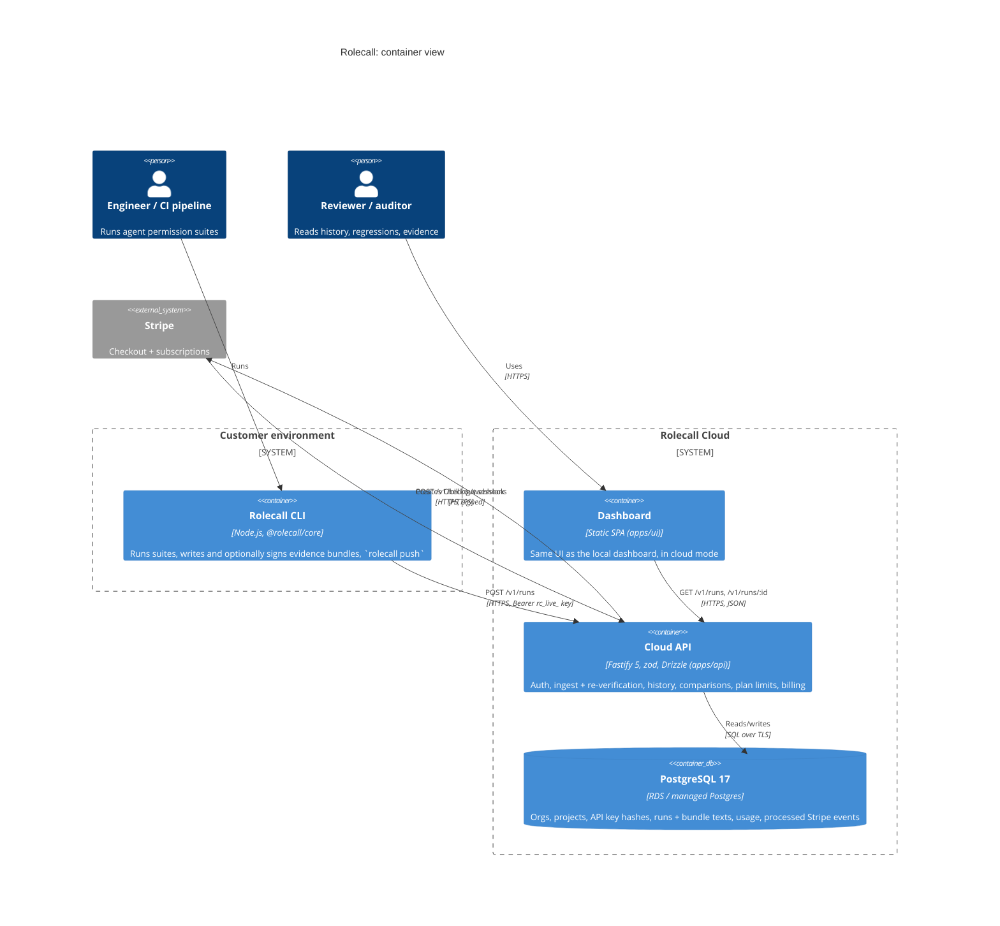

# Rolecall architecture

Rolecall has two halves. The **open-source CLI** (`packages/core`, `packages/cli`) runs permission suites locally or in
CI and writes a tamper-evident *evidence bundle* (`manifest.json`, `results.json`, `events.jsonl`, optional
`signature.json`). **Rolecall Cloud** (`apps/api` + the dashboard in `apps/ui`) stores those bundles per organization
and project, re-verifies them, shows history and regressions, and is where the product is monetized through plan
limits.

## System context and containers



## Cloud API (`apps/api`)

### Layers

```
routes      declare path, zod schemas (→ validation + OpenAPI), required scopes; bind a controller method
controller  HTTP ↔ service: pulls auth/params/body off the request, sets status codes
service     business rules (verification, dedupe, quotas, plan changes); depends on repository *interfaces*
repository  the only code that imports Drizzle; every tenant read takes orgId and filters by it
```

`src/app.ts` (`buildApp(deps)`) is the composition root and the only place that instantiates concrete classes. Tests
call it with in-memory PGlite and inject nothing else; alternative billing gateways or clocks can be injected.
Cross-cutting concerns are Fastify plugins in `src/plugins`: the error handler (single error shape, no stack traces),
bearer-key auth (`app.requireAuth(...scopes)` → `request.auth`), Swagger (`/docs`), and security (helmet, CORS
allow-list, rate limiting per key or IP).

Modules (`src/modules/*`): `organizations` (signup), `projects`, `api-keys`, `runs`, `billing`, `health`.

### Ingest pipeline (`POST /v1/runs`)

1. Authenticate (`runs:write`), resolve project: key binding → `?project=` → the org's only project.
2. `verifyBundleFiles` from `@rolecall/core` recomputes file hashes, the manifest root hash and the signature.
   Failure → `422 invalid_bundle` with `details.problems`.
3. Structural checks (zod) and cross-checks (`manifest.summary == results.summary`, suite hash).
4. Dedupe on `(project_id, root_hash)` → `200 { id, duplicate: true }` (idempotent CI retries).
5. Quota: atomic conditional upsert on `usage_counters` (`runs < limit`) → `402 plan_limit_reached`.
6. Store raw texts (they are the evidence) plus denormalized columns for listing/filtering.

`GET /v1/runs/:id` re-verifies the stored texts on every read and compares against the previous run of the same suite
on the project's default branch with `compareRuns`. List and detail responses use the exact `RunListItem` and
`RunDetail` shapes from `@rolecall/core`, so the dashboard renders local, static and cloud data with the same code.

### Data model

`organizations` (plan, Stripe ids) → `projects` (default branch) → `runs` (bundle texts, root hash, summary, git);
`api_keys` (sha256 hash, 8-char prefix, scopes, optional project binding, revoked_at); `usage_counters` (org, UTC month);
`processed_events` (Stripe event ids). Migrations: `apps/api/drizzle/`.

### Decisions

- [ADR 0001: Layered modular architecture](adr/0001-layered-architecture.md)
- [ADR 0002: Postgres + Drizzle, PGlite for dev/test](adr/0002-postgres-drizzle-pglite.md)
- [ADR 0003: API key authentication model](adr/0003-api-key-auth.md)
- [ADR 0004: Server-side re-verification of bundles](adr/0004-server-side-reverification.md)
- [ADR 0005: Plan limits and billing](adr/0005-plan-limits.md)
- [ADR 0006: Everything open source](adr/0006-open-core-licensing.md)
